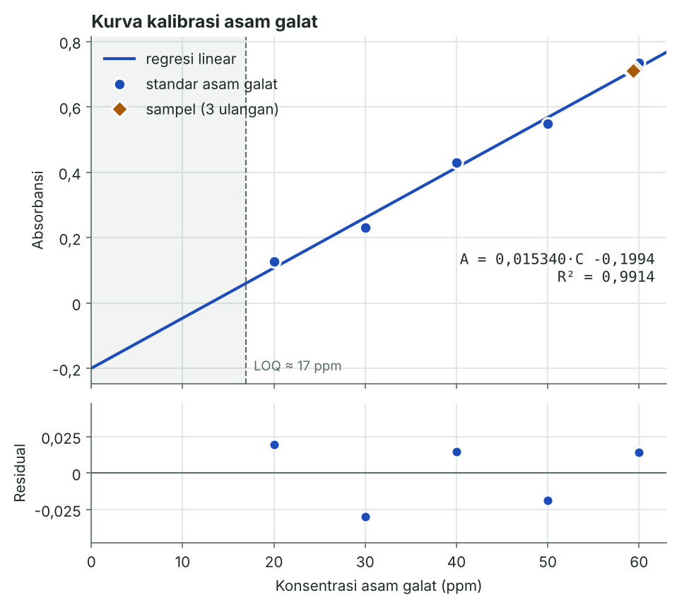
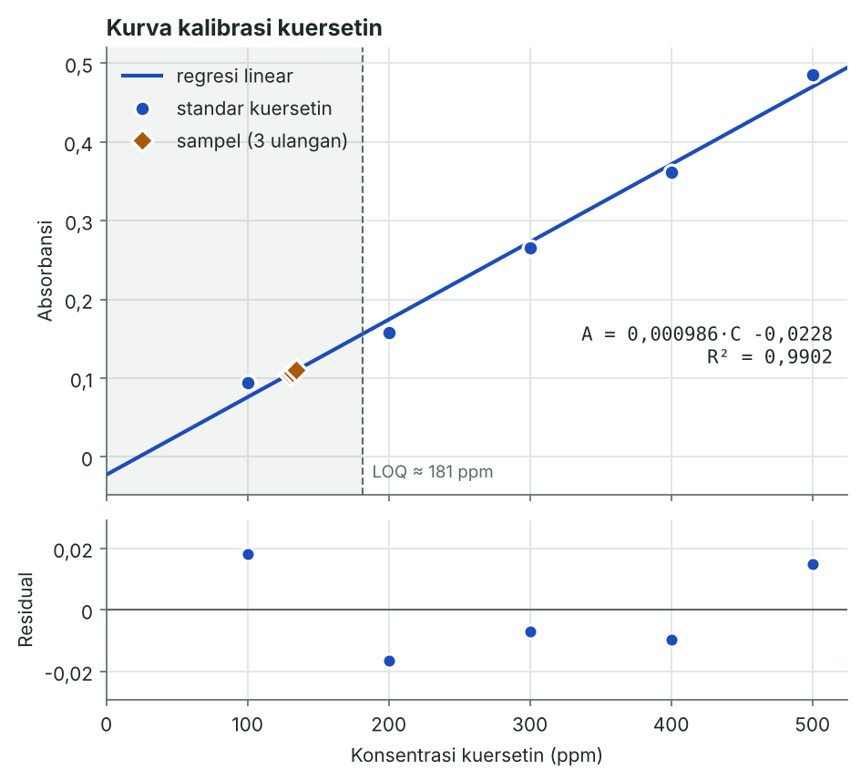
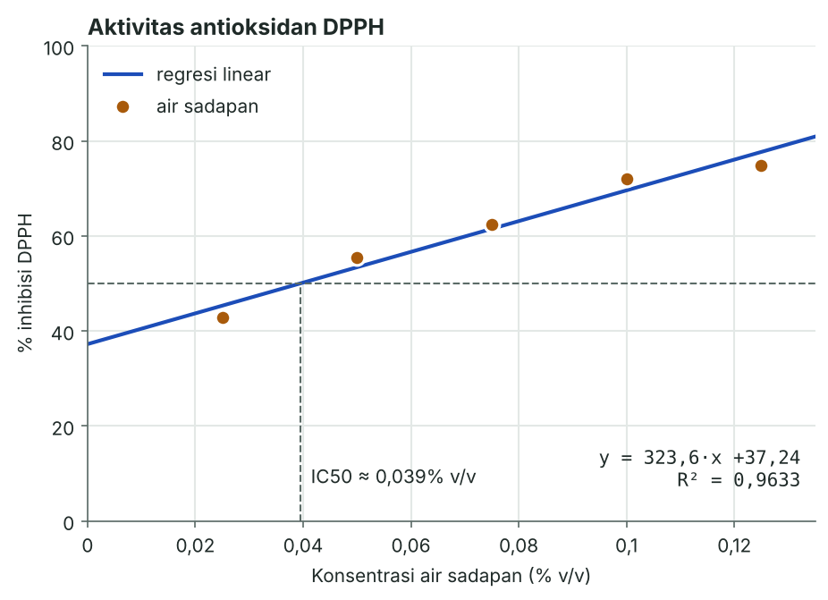

# Air sadapan batang semu pisang merah: fenolik, flavonoid, dan antioksidan

Analisis ulang data tugas akhir saya tentang air sadapan batang semu pisang merah (*Musa acuminata* Colla 'Red Dacca'). Pengukuran dilakukan pada Januari–Februari 2026 di Laboratorium Jurusan Pendidikan Kimia, FKIP Universitas Halu Oleo, Kendari.

Skrip `analisis.py` menghitung ulang semua angka Bab IV dari data absorbansi mentah, lalu menambahkan pemeriksaan yang belum ada di skripsi: residual kurva kalibrasi, perkiraan LOD/LOQ, dan IC50.

## Metode

| Uji | Metode | Standar | Panjang gelombang |
|---|---|---|---|
| Kadar total fenolik (KTF) | Folin–Ciocalteu (ISO/DIS 14502-1) | asam galat, 20–60 ppm | 765 nm |
| Kadar total flavonoid (KTFla) | kolorimetri NaNO₂–AlCl₃–NaOH | kuersetin, 100–500 ppm | 420 nm |
| Aktivitas antioksidan | peredaman radikal DPPH (4 mg dalam 100 mL etanol), 30 menit dalam gelap | vitamin C 3 ppm sebagai kontrol positif | 517 nm |

Sampel berupa air sadapan segar yang disaring dengan kertas Whatman no. 1, tanpa pengeringan. KTF dan KTFla diukur tiga kali (simplo, duplo, triplo). DPPH diuji pada lima konsentrasi, 0,025–0,125% v/v.

## Hasil

| Parameter | Hasil (skripsi) |
|---|---|
| Kadar total fenolik | 1,191 ± 0,004 mg GAE/g sampel segar (RSD 0,34%) |
| Kadar total flavonoid | 0,433 ± 0,008 mg QE/g sampel segar (RSD 1,87%) |
| % inhibisi DPPH | 55,37% pada 0,05% v/v; 74,90% pada 0,125% v/v |
| Kontrol positif vitamin C 3 ppm | 52,58% |
| IC50 DPPH (dihitung ulang, tidak ada di skripsi) | ≈ 0,039% v/v (regresi linear, R² 0,963) |

Skrip mereproduksi semua angka skripsi persis bila memakai koefisien kurva yang sama dengan Excel. Perbandingan lengkapnya ada di [`hasil/ringkasan.md`](hasil/ringkasan.md).







## Catatan dan batasan

Hal-hal ini saya temukan saat menghitung ulang, dan saya tulis supaya angkanya tidak dibaca lebih kuat dari datanya.

1. **Pembulatan koefisien kurva.** Excel memakai kemiringan kurva kuersetin 0,001, sedangkan hasil regresi penuhnya 0,000986. Dengan koefisien penuh, KTFla menjadi 0,439 mg QE/g (skripsi: 0,433). Untuk fenolik bedanya lebih kecil: 1,188 versus 1,191 mg GAE/g.
2. **Flavonoid di bawah LOQ.** Dari simpangan residual kurva kuersetin, LOQ diperkirakan sekitar 181 ppm. Konsentrasi sampel terbaca sekitar 130 ppm, jadi kuantifikasinya kurang andal. Perbaikannya: kurva dengan standar lebih rendah (misalnya 25–200 ppm) atau sampel yang lebih pekat. Kurva asam galat aman: LOQ sekitar 17 ppm, sampel sekitar 59 ppm.
3. **Kurva asam galat hanya berlaku di rentangnya.** Intersepnya −0,20, jadi garis memotong A = 0 di sekitar 13 ppm. Kurva hanya dipakai di rentang standar 20–60 ppm, dan sampel berada di ujung atas rentang itu.
4. **Arti RSD.** Tiga ulangan adalah ulangan pengukuran dari air sadapan yang sama. RSD menggambarkan keterulangan pengukuran, bukan variasi antar tanaman.
5. **Rasio flavonoid terhadap fenolik.** Skripsi menyebut proporsi 36,36%. Angka ini membagi ekuivalen kuersetin dengan ekuivalen asam galat dari dua reaksi yang berbeda, jadi lebih tepat dibaca sebagai rasio KTFla/KTF, bukan persen massa.
6. **DPPH.** Setiap konsentrasi diukur satu kali dan absorbansinya dicatat dua desimal. Vitamin C hanya diuji pada satu konsentrasi, jadi IC50-nya tidak bisa dibandingkan. Tidak ada blanko warna sampel (sampel tanpa DPPH), padahal skripsi menduga antosianin, pigmen merah keunguan, ikut terlarut di air sadapan.
7. **RSD flavonoid 1,93% versus 1,87%.** Skripsi menghitung SD dari nilai yang sudah dibulatkan ke tiga desimal. Dari nilai yang belum dibulatkan, RSD-nya 1,93%. Keduanya di bawah 2%.

## Menjalankan

```bash
pip install -r ../requirements.txt
python analisis.py
```

Grafik dan `ringkasan.md` akan ditulis ulang di folder `hasil/`.

```
skripsi-red-dacca/
├── analisis.py          skrip analisis
├── data/                data absorbansi mentah (CSV)
└── hasil/               grafik dan ringkasan, dihasilkan oleh skrip
```

Data, prosedur laboratorium, dan interpretasi berasal dari skripsi saya. Skrip dan README disusun dengan bantuan Claude (Anthropic).
